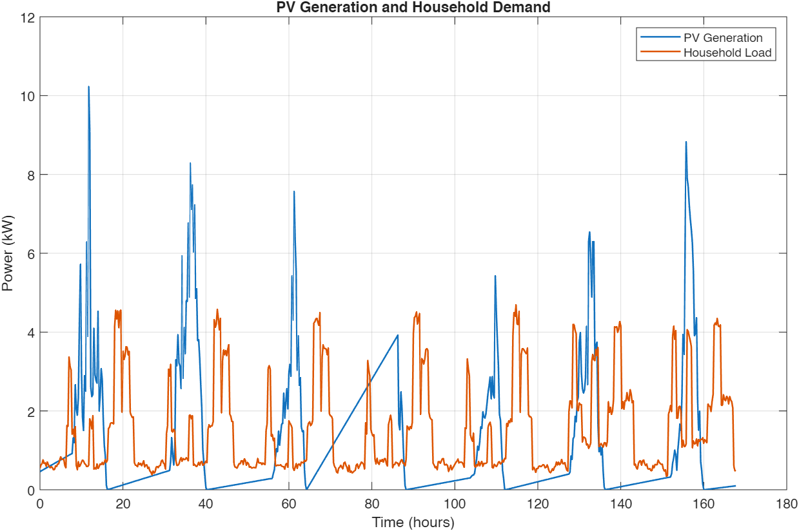
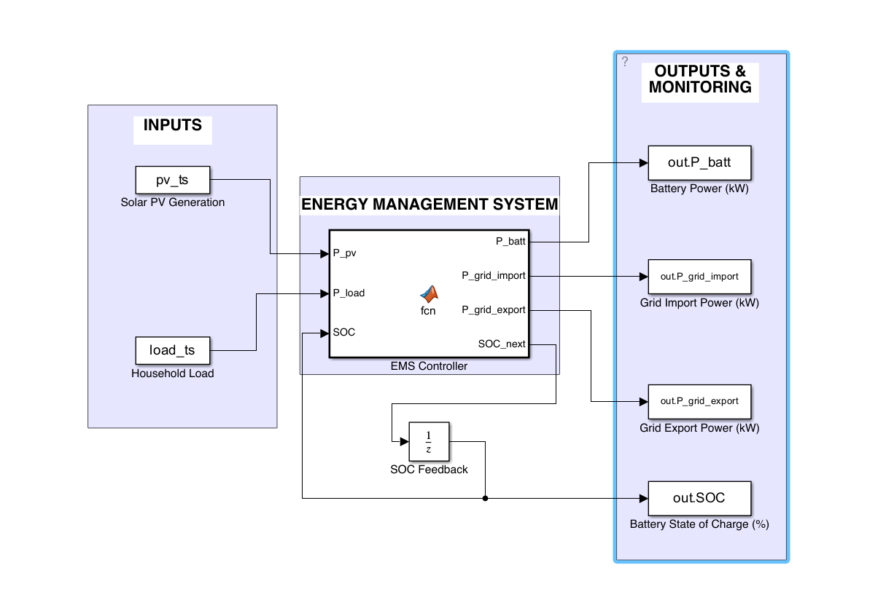
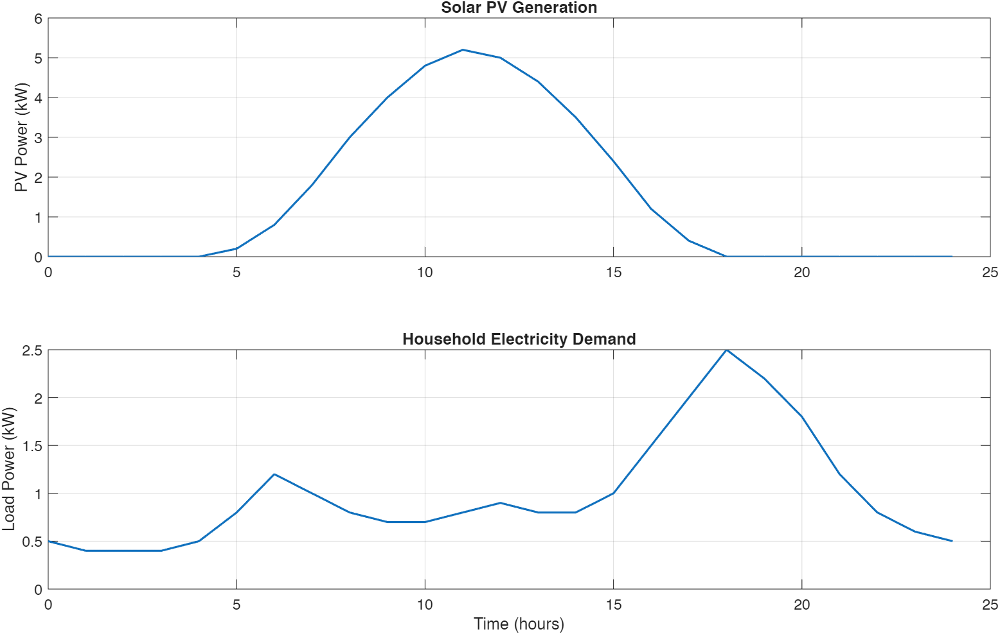
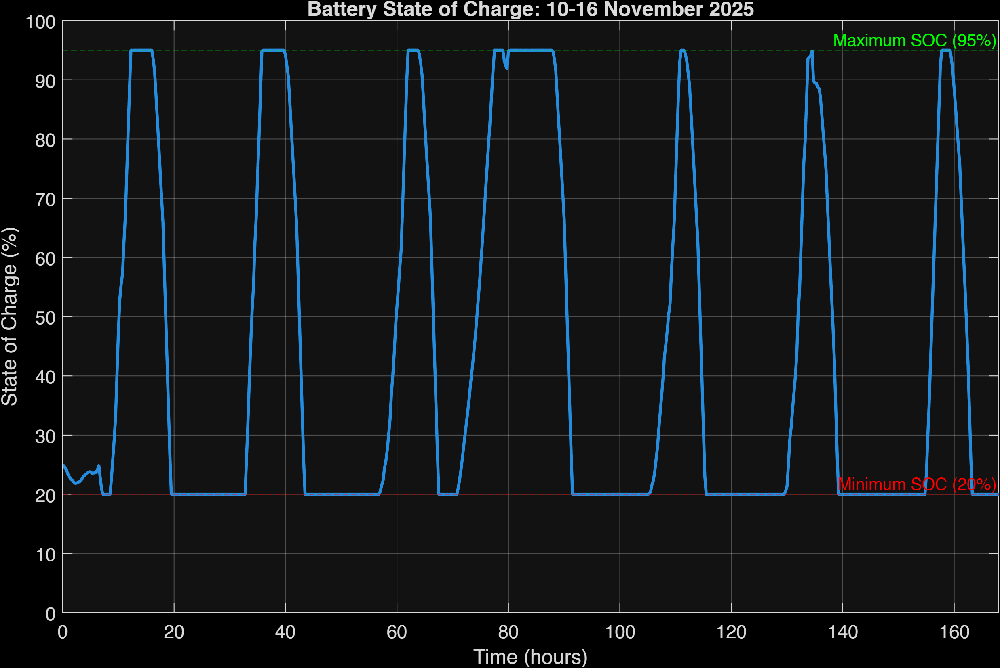
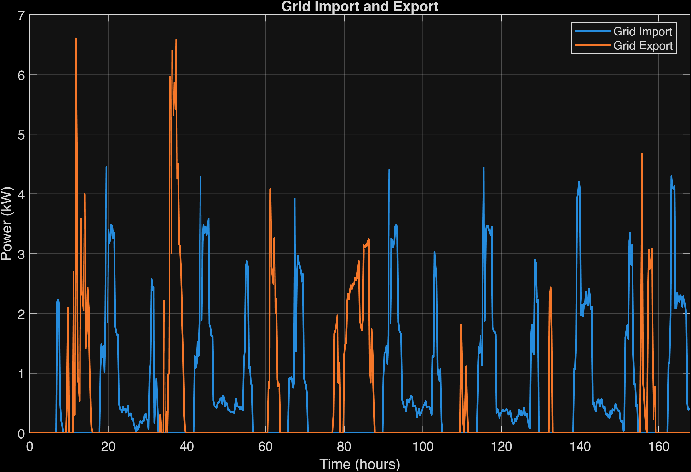
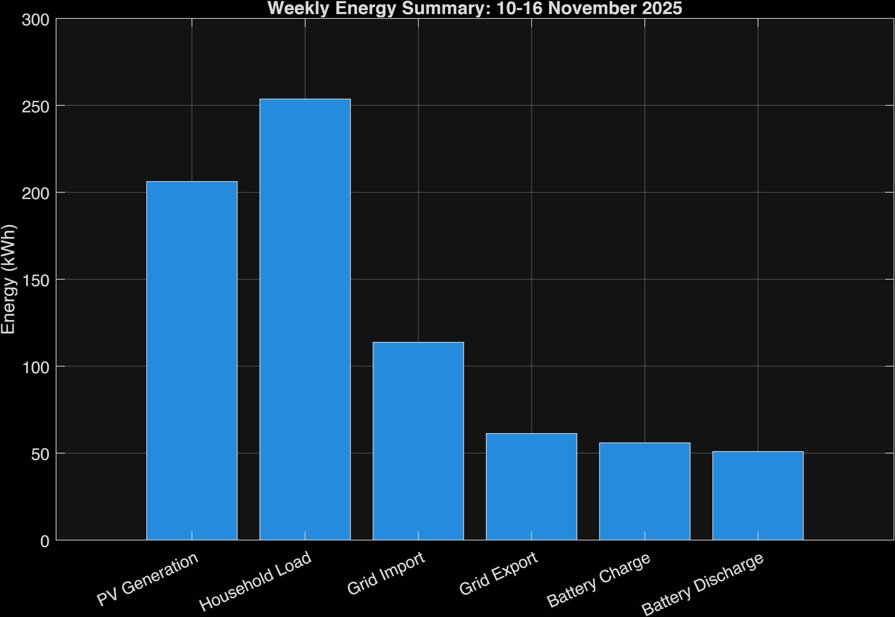

# Solar PV and Battery Energy Management

**MATLAB/Simulink study of household solar generation, battery storage and grid exchange.**

Author: **Mohammad Rayhanul Haque**



## Project objective

Explore how a household can use solar PV, store surplus electricity in a battery, and exchange the remaining power with the grid. A rule-based controller prioritizes local demand, battery charging/discharging, then grid export/import.

This repository preserves an earlier project, its source spreadsheets and historical plots. It includes both a simple illustrative daily scenario and a selected-week data case. It is a power/energy model, not a detailed inverter or electrochemical battery simulation.

## Simulink architecture



1. PV generation and household load enter through `From Workspace` blocks.
2. The MATLAB Function block calculates net PV power and allocates battery/grid power.
3. A Unit Delay returns the previous SOC to the EMS.
4. To Workspace blocks log battery power, grid import/export and SOC.

**Battery power convention:** positive means charging; negative means discharging. Grid import and export are separate nonnegative signals. SOC is stored as a fraction; the plotting scripts convert it to percent, despite the logging block's percentage label.

## Controller parameters

| Parameter | Value |
|---|---:|
| Battery capacity | 10 kWh |
| Maximum charge / discharge power | 3 / 3 kW |
| SOC limits | 20-95% |
| Charge/discharge efficiency per direction | 0.95 |
| Embedded EMS update interval | 0.25 h (15 minutes) |
| Setup script initial SOC | 50% |

The embedded function has its own hard-coded parameters. Changing workspace variables alone does not update those controller constants. `reference/EMS_Controller.m` is a readable extracted snapshot; the actual simulation executes the function embedded in `PV_BESS_EMS.slx`.

### Control decisions

- **PV exceeds demand:** charge the battery within power/SOC limits, then export the remaining surplus.
- **Demand exceeds PV:** discharge the battery within power/SOC limits, then import the remaining deficit.
- The controller does not intentionally charge from the grid.

Power accounting uses:

```text
PV generation + grid import = household load + battery power + grid export
```

## Two study scenarios

### Illustrative 24-hour example

`PV_BESS_setup.m` creates synthetic hourly solar and household profiles. These are explicitly illustrative, not measured. Its declared one-hour timestep differs from the saved controller's 15-minute interval, so it must not be treated as a fully synchronized hourly model without reconciling the settings.



### Selected week: November 10-16, 2025

`PV_BESS_Actual_Week.m` selects 672 timestamps at 15-minute spacing, combines four inverter channels and a sun-tracker channel, and reads column 8 of the household-load workbook.

The script assumes inverter power is in watts and divides by 1,000. Units and measurement provenance require confirmation from the original equipment/data documentation. The load workbook is labeled a measured profile template; the supplied files alone do not establish its measurement provenance.

The supplied PV values contain nighttime output and long near-linear ramps. These are preserved rather than silently corrected. This repository does not assert that all input points are independently verified raw measurements.

## Historical results

The following values come from the original `PV_BESS_Plots/Weekly_Energy_Summary.csv`. They were not regenerated during repository preparation.

| Metric | Saved energy (kWh) |
|---|---:|
| PV generation | 206.195 |
| Household demand | 253.649 |
| Grid import | 113.733 |
| Grid export | 61.290 |
| Battery charging | 55.916 |
| Battery discharging | 50.929 |





The original summary integrates with `trapz`; interpret these as the saved study's accounting results, not independently rerun or validated performance claims. Check discrete interval integration, final intervals, input interpolation and initial/final SOC before comparing alternatives or reporting savings.

## Requirements and running

- MATLAB and Simulink. The saved model metadata identifies **R2025b**.
- Keep the model, scripts and three workbooks together in the repository root.
- Download with **Code > Download ZIP** and extract before running.
- Run from the MATLAB Command Window/base workspace.

```matlab
run_actual_week
```

### What the added helper does

The helper calls the original weekly preparation script, sets initial SOC explicitly to 50%, and uses a fixed 0.25-hour discrete step with zero-order-held inputs. The final input sample at 167.75 h is held through 168 h. It loads the model by full path and applies settings in memory without overwriting the saved model.

These explicit settings may differ from the historical run: supplied plots appear to start near 25%, and the archived model uses automatic variable-step solver settings. Set the helper's `SOC_initial` to `0.25` if investigating that starting condition. Exact reproduction of the historical figures is not claimed.

Setup/preparation clears the workspace and closes figures. It recreates the selected-week workbook and MAT file in the extracted repository copy. New complete input/results data is saved separately to `results/PV_BESS_weekly_run.mat`.

After a successful run, `PV_BESS_results` creates the basic figures. The optional command below regenerates the portfolio figures and CSV, replacing the historical snapshots in `PV_BESS_Plots/`:

```matlab
PV_BESS_Portfolio_Plots
```

The complete MATLAB/Simulink workflow has not been executed during repository preparation. Numerical controller logic and the original model are preserved; the helper is provided for review and local execution.

## Repository contents

| File or folder | Purpose |
|---|---|
| `PV_BESS_EMS.slx` | Original Simulink model |
| `PV_BESS_setup.m` | Illustrative daily setup |
| `PV_BESS_Actual_Week.m` | Weekly PV/load import and selection |
| `PV_BESS_results.m` | Basic result figures |
| `PV_BESS_Portfolio_Plots.m` | Detailed plots and energy summary |
| `run_actual_week.m` | Added helper with explicit weekly settings |
| `PV_202510-202610.xlsx` | Supplied source PV workbook |
| `PV_Production_Selected_Week.xlsx` | Archived selected-week PV table |
| `PV_BESS_Household_Load_Profile_Nov2025-v2.xlsx` | Supplied household profile workbook |
| `PV_BESS_Actual_Week.mat` | Archived PV input arrays and MATLAB objects |
| `PV_BESS_Plots/` | Historical figures and energy summary |
| `images/` | Model and additional original figures |
| `docs/` | Model diagram PDF and reproduction notes |
| `reference/` | Extracted controller source for browsing |

## Known limitations

Read [reproduction notes](docs/reproduction_notes.md) before interpreting the input data or changing simulation settings. Key issues are timestep consistency, input provenance/units, initial SOC, the preparation script's overwritten MAT snapshot, and the portfolio script's integration conventions.

No battery degradation, thermal behavior, converter dynamics, grid capacity constraints, electricity tariffs or measured economic savings are modeled. This is a rule-based demonstration, not an optimized dispatch or validated installation design.

[View the original simulation diagram PDF](docs/simulation_setup.pdf)
